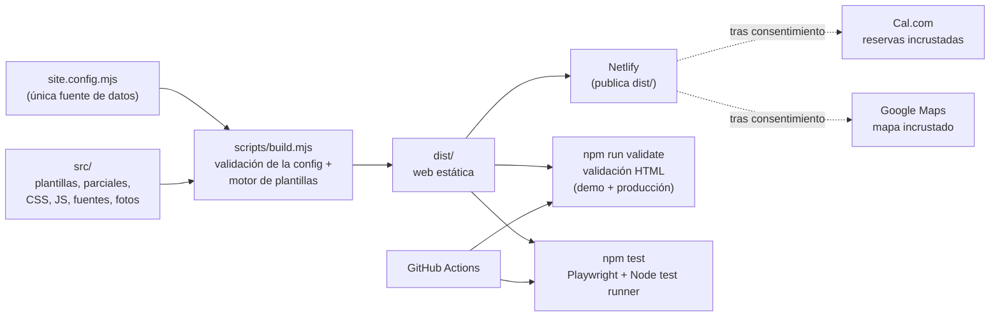

# JM Web Studio — web de salón de belleza: demostración y plantilla

[English](README.md) · **Español**

[](https://github.com/jmartintechit-blip/JM-Web-Studio/actions/workflows/ci.yml)
[](LICENSE)
[](https://jmwebstudiodemo.netlify.app/)

Web de un salón ficticio de uñas y estética que además sirve como plantilla reutilizable: un salón pequeño puede mostrar sus servicios y precios y recibir reservas online sin contratar a un desarrollador para cada cambio.

**Qué no es.** No es un negocio real: *Azahar Nail Studio*, su dirección y sus reseñas son inventados, y la web lo avisa. No es un CMS, una tienda ni un motor de reservas: no hay backend ni base de datos, y las reservas las gestiona un calendario de [Cal.com](https://cal.com) incrustado. Las páginas legales son plantillas, no asesoramiento jurídico.

| Escritorio | Móvil (primera pantalla) |
| --- | --- |
|  |  |
|  |  |

**Demo en vivo:** <https://jmwebstudiodemo.netlify.app/>. Las capturas de arriba usan un teléfono ficticio.

## Por qué existe

Los salones pequeños suelen no tener web, o tener una que no pueden editar. Este proyecto sirve para enseñar a la dueña de un salón una web terminada y de calidad para *su* tipo de negocio antes de pedirle nada, y después reutilizar el mismo código para el cliente real:

1. **Una web de demostración** que se puede enviar como enlace, personalizable con `?para=Nombre`.
2. **Una plantilla**: cada texto, servicio, precio, enlace de reservas, dato de contacto, horario, color y campo legal sale de un único archivo, [`site.config.mjs`](site.config.mjs). Para la web de un cliente se cambia ese archivo y las fotos; con `modoDemo: false` queda lista para producción.

## Funcionalidades

- **Un único archivo de configuración** para toda la web (negocio, contacto, horario, servicios, textos, reseñas, fotos, colores, datos legales).
- **Modo demo y modo producción** con el mismo código (ver la tabla de abajo).
- **Reserva online por servicio** con Cal.com, que se carga solo tras el consentimiento del visitante.
- **Google Maps** también tras consentimiento; banner de cookies y páginas legales (aviso legal, privacidad, cookies).
- **Indicador «abierto ahora»** calculado desde el horario configurado, con franjas partidas y pausa de mediodía.
- **Enlace de demo personalizado** con `?para=Nombre` (el nombre se inserta siempre como texto, nunca como HTML, con un máximo de 60 caracteres).
- **Primera pantalla pensada para móvil**: barra de demo, nombre del salón, foto grande y botón *Reservar* visibles sin hacer scroll a 390×844.
- **Comprobaciones de accesibilidad y SEO** en los tests, incluido el contraste WCAG AA de la paleta configurada.
- **Tipografías autoalojadas** (sin CDN de fuentes) y un build estático sin dependencias en ejecución.

### Modo demo frente a modo producción

| | `modoDemo: true` (demo) | `modoDemo: false` (producción) |
| --- | --- | --- |
| Barra de demo y `?para=` | Sí | No se generan |
| Notas «Reseñas de ejemplo», «Dirección de ejemplo», «Página de ejemplo» | Sí | No |
| Botón de WhatsApp del salón | Escribe al autor de la demo | Escribe al negocio (`contacto.whatsappTexto`) |
| `<meta name="robots">` | `noindex, nofollow` en todas las páginas | Ninguna (la 404 conserva `noindex`) |
| `robots.txt` | `Disallow: /` | `Allow: /` + enlace al sitemap |
| `sitemap.xml` | No se genera | Se genera |
| Datos estructurados (schema.org) | Ninguno | Del negocio local, generados desde la configuración |
| Título y descripción al compartir | `demo.ogTitulo`, `demo.ogDescripcion` | `textos.titulo`, `textos.descripcionCorta` |
| URL pública | `SITE_URL` / `URL` de Netlify | `sitio.url` (obligatoria) |

Con `modoDemo: false` el build **falla** si faltan datos imprescindibles (URL del sitio, dirección completa) y **avisa** de lo que siga pendiente.

## Arquitectura



El build es un pequeño generador de sitios estáticos propio (`{{x}}`, `{{{raw}}}`, `#if`, `#unless`, `#each`, parciales) sin dependencias en ejecución. La única carpeta que se publica es `dist/`.

## Tecnologías

| Área | Tecnología |
| --- | --- |
| Web | HTML, CSS y JavaScript sin framework |
| Build | Node.js ≥ 20.12, motor de plantillas propio (`scripts/template.mjs`) |
| Reservas | Calendario incrustado de [Cal.com](https://cal.com) |
| Alojamiento | Netlify (`netlify.toml`) |
| Tests de navegador | Playwright 1.56.1 (Chromium) |
| Ejecutor de tests | Test runner integrado de Node.js |
| Validación HTML | html-validate |
| CI | GitHub Actions, Dependabot |
| Tipografías | Instrument Serif y Hanken Grotesk (SIL OFL 1.1), autoalojadas |

## Inicio rápido

```bash
git clone https://github.com/jmartintechit-blip/JM-Web-Studio.git && cd JM-Web-Studio
npm install
npm run dev        # http://localhost:8765
```

Otros comandos:

```bash
npx playwright install chromium  # solo la primera vez, necesario para los tests
npm run build                    # genera dist/ (en local y en modo demo necesita SITE_URL)
npm run validate                 # compila en modo demo y producción y valida el HTML de ambos
npm test                         # batería completa de pruebas
npm run assets                   # regenera la imagen para compartir y los iconos desde la configuración
npm run screenshots              # regenera docs/images/ (con un teléfono ficticio)
```

### Crear la web de un cliente nuevo

Todo lo que no es de este salón vive en `site.config.mjs` y en `src/assets/img/photos/`. No hay que tocar HTML, CSS ni JavaScript.

1. Copia el proyecto (clónalo o usa el repositorio como plantilla) y ejecuta `npm install`.
2. Edita [`site.config.mjs`](site.config.mjs); cada bloque está comentado: `negocio` (nombre, marca, dirección, consulta del mapa), `contacto`, `horario` (**debe coincidir con la disponibilidad de Cal.com**), `reservas` (usuario de Cal.com y lista de servicios con minutos, precio y `slug`), `textos`, `resenas` (**solo reseñas reales** y con permiso, o una lista vacía), `colores`, `legal`.
3. Sustituye las fotos de la demo en `src/assets/img/photos/` por las del cliente y escribe el texto alternativo de cada una en `fotos`. No presentes fotos de stock como si fueran del local.
4. Ejecuta `npm run assets` para regenerar la imagen para compartir y los iconos.
5. Pon `modoDemo: false` y `sitio.url: 'https://www.ejemplo.com'`.
6. Ejecuta `npm run build` (imprime avisos de lo que falta) y `npm test`.
7. Publica en Netlify (`publish = "dist"` y `command = "node scripts/build.mjs"` ya están en `netlify.toml`).

Los servicios reservables de la demo son: manicura semipermanente (45 min, 18 €), uñas de gel (90 min, 35 €), relleno de gel (75 min, 28 €), pedicura semipermanente (60 min, 25 €) y limpieza facial (45 min, 30 €). Cada uno abre su propio evento de Cal.com.

## Pruebas y calidad

`npm test` ejecuta **134 pruebas en 19 suites** (todas pasan en el momento de escribir esto; las mismas comprobaciones se ejecutan en CI en cada push a `main` y en cada pull request). Se ejecutan en Chromium real a cinco anchos (360–1920 px) y cubren:

- errores de consola, peticiones fallidas y desbordamiento horizontal;
- enlaces y anclas; comprobaciones estáticas de SEO y accesibilidad; contraste WCAG AA de la paleta configurada;
- que la página muestre exactamente lo configurado, incluidas las reservas por servicio y el consentimiento (contra un doble local del `embed.js` de Cal.com);
- diseño móvil, teclado, movimiento reducido y peso de la página (recursos críticos por debajo de 250 KB y primera carga por debajo de 450 KB, sin comprimir);
- el indicador «abierto ahora» con reloj fijo en todas las franjas del horario;
- modo demo: texto exacto de la barra y de los mensajes de WhatsApp, casos límite de `?para=` (inyección de HTML, caracteres de control, límite de 60 caracteres, valor vacío), `noindex`, `robots.txt`, sin sitemap ni datos estructurados, Open Graph y la primera pantalla a 390×844;
- modo producción: sin rastro de la demo, indexable, schema.org coherente con lo visible, `robots.txt` y `sitemap.xml`;
- modo plantilla: un negocio de prueba totalmente distinto (`tests/fixtures/otro-negocio.config.mjs`) se compila sin que quede ningún dato de la demo.

`npm run validate` valida además con html-validate el HTML compilado de ambos modos.

## Seguridad

- Sin backend, base de datos ni cuentas de usuario: el resultado son archivos estáticos.
- El contenido de terceros (Cal.com, Google Maps) se carga solo tras consentimiento explícito.
- El valor de `?para=` se inserta como texto, nunca como HTML.
- Las cabeceras de seguridad se definen en `netlify.toml` (`X-Content-Type-Options`, `X-Frame-Options`, `Referrer-Policy`, `Permissions-Policy`).
- El escaneo de secretos de GitHub con protección en el push está activado; Dependabot revisa semanalmente los paquetes npm y GitHub Actions.
- Para informar de una vulnerabilidad, consulta [SECURITY.md](SECURITY.md).

## Límites conocidos

- Verificado solo en Chromium (no en Safari ni en Firefox) y sin lectores de pantalla.
- El calendario real de Cal.com y el mapa de Google no se pudieron cargar desde el entorno de desarrollo (sin acceso a internet allí); la integración se prueba con un doble de `embed.js`. Los enlaces externos no se comprobaron en vivo.
- La disponibilidad de Cal.com vive fuera de este repositorio y hay que mantenerla alineada con `horario` a mano; en la última comprobación, la disponibilidad de las mañanas de lunes a viernes empezaba a las 09:00 mientras la web muestra las 10:00.
- No hay `Content-Security-Policy`, porque el calendario de Cal.com no se probó contra una política concreta.
- Los textos legales son orientativos: que los revise un profesional antes de publicar una web real.
- La imagen para compartir (`og-image.jpg`) es un archivo: ejecuta `npm run assets` tras cambiar el negocio.
- No se ha ejecutado Lighthouse.
- El teléfono de `site.config.mjs` es el contacto de WhatsApp del autor de la demo; sustitúyelo al reutilizar la plantilla.

## Hoja de ruta

Ideas, no compromisos:

- Ejecutar la batería también en Firefox y WebKit, además de Chromium.
- Añadir una `Content-Security-Policy` cuando se haya probado el calendario de Cal.com con ella.
- Medir con Lighthouse y anotar aquí los resultados.
- Comprobar automáticamente la disponibilidad de Cal.com frente a `horario`.

## Asistencia de IA

Este proyecto se ha desarrollado con asistencia de IA (Claude Code). El mantenedor fijó los requisitos y la dirección; el código, las pruebas y la documentación se escribieron junto con un modelo de IA.

## Licencias

El código se distribuye bajo la [licencia MIT](LICENSE). No cubre los recursos de terceros: las tipografías *Instrument Serif* y *Hanken Grotesk* (SIL Open Font License 1.1) y las fotografías de la demo, de [Unsplash](https://unsplash.com), con la [licencia de Unsplash](https://unsplash.com/license).
