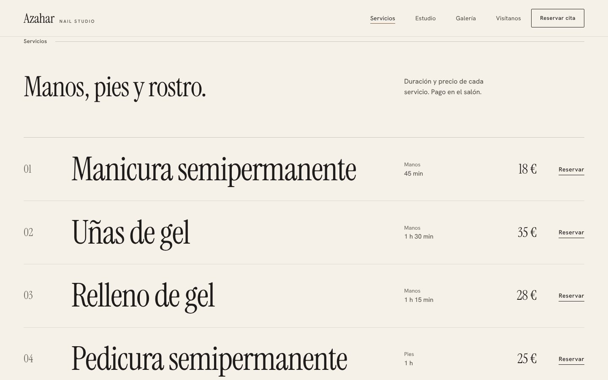
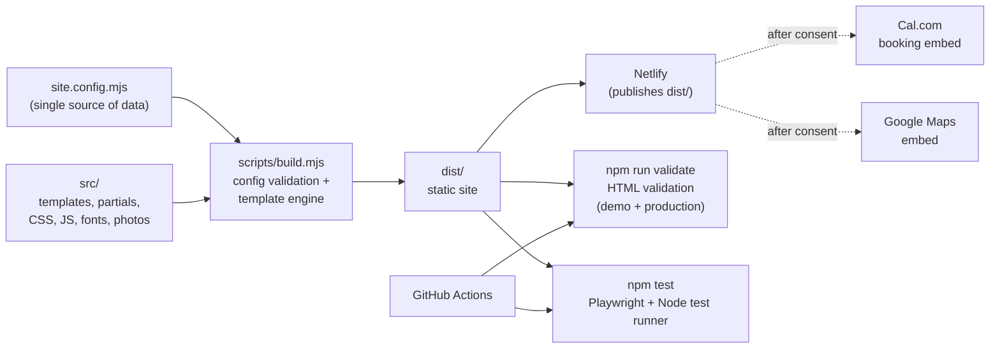

# JM Web Studio — salon website demo and template

**English** · [Español](README.es.md)

[](https://github.com/jmartintechit-blip/JM-Web-Studio/actions/workflows/ci.yml)
[](LICENSE)
[](https://jmwebstudiodemo.netlify.app/)

A fictional nail and beauty salon website that doubles as a reusable template: a small salon can show its services and prices and take online bookings without hiring a developer for every change.

**What this is not.** It is not a real business: *Azahar Nail Studio*, its address and its reviews are invented, and the site says so. It is not a CMS, a shop or a booking engine: there is no backend and no database, and bookings are handled by an embedded [Cal.com](https://cal.com) calendar. The legal pages are templates, not legal advice.

| Desktop | Mobile (first screen) |
| --- | --- |
|  |  |
|  |  |

**Live demo:** <https://jmwebstudiodemo.netlify.app/>. The screenshots above use a fictitious phone number.

## Why it exists

Small salons usually have either no website or one they cannot edit. This project is a way to show a salon owner a finished, high-quality site for *their* kind of business before asking for anything, and then reuse the same code for the real client:

1. **A demo site** that can be sent as a link, optionally personalised with `?para=Name`.
2. **A template**: every text, service, price, booking link, contact detail, opening hour, colour and legal field comes from one file, [`site.config.mjs`](site.config.mjs). To build a client site you change that file and the photos; with `modoDemo: false` it is ready for production.

## Features

- **One configuration file** for the whole site (business, contact, opening hours, services, texts, reviews, photos, colours, legal data).
- **Demo mode and production mode** from the same code (see the table below).
- **Per-service online booking** through Cal.com, loaded only after the visitor gives consent.
- **Google Maps** also behind a consent gate; cookie banner and legal pages (legal notice, privacy, cookies).
- **"Open now" indicator** computed from the configured opening hours, including split shifts and a midday break.
- **Personalised demo link** with `?para=Name` (the name is always inserted as text, never as HTML, capped at 60 characters).
- **Mobile-first first screen**: demo bar, salon name, large photo and the *Book* button are visible without scrolling at 390×844.
- **Accessibility and SEO checks** in the test suite, including WCAG AA contrast of the configured palette.
- **Self-hosted fonts** (no font CDN) and a static build with no runtime dependencies.

### Demo mode vs production mode

| | `modoDemo: true` (demo) | `modoDemo: false` (production) |
| --- | --- | --- |
| Demo bar and `?para=` | Yes | Not generated |
| "Sample reviews", "Sample address", "Sample page" notes | Yes | No |
| Salon WhatsApp button | Writes to the demo author | Writes to the business (`contacto.whatsappTexto`) |
| `<meta name="robots">` | `noindex, nofollow` on every page | None (the 404 page keeps `noindex`) |
| `robots.txt` | `Disallow: /` | `Allow: /` plus sitemap link |
| `sitemap.xml` | Not generated | Generated |
| Structured data (schema.org) | None | Local-business data built from the configuration |
| Share preview title/description | `demo.ogTitulo`, `demo.ogDescripcion` | `textos.titulo`, `textos.descripcionCorta` |
| Public URL | `SITE_URL` / Netlify `URL` | `sitio.url` (required) |

With `modoDemo: false` the build **fails** if essential data is missing (site URL, full address) and **warns** about anything still pending.

## Architecture



The build is a small custom static-site generator (`{{x}}`, `{{{raw}}}`, `#if`, `#unless`, `#each`, partials) with no runtime dependencies. The only folder that is published is `dist/`.

## Technologies

| Area | Technology |
| --- | --- |
| Site | Plain HTML, CSS and JavaScript (no framework) |
| Build | Node.js ≥ 20.12, custom template engine (`scripts/template.mjs`) |
| Booking | [Cal.com](https://cal.com) embed |
| Hosting | Netlify (`netlify.toml`) |
| Browser tests | Playwright 1.56.1 (Chromium) |
| Test runner | Node.js built-in test runner |
| HTML validation | html-validate |
| CI | GitHub Actions, Dependabot |
| Fonts | Instrument Serif and Hanken Grotesk (SIL OFL 1.1), self-hosted |

## Quick start

```bash
git clone https://github.com/jmartintechit-blip/JM-Web-Studio.git && cd JM-Web-Studio
npm install
npm run dev        # http://localhost:8765
```

Other commands:

```bash
npx playwright install chromium  # first time only, needed for the tests
npm run build                    # generates dist/ (needs SITE_URL locally in demo mode)
npm run validate                 # builds in demo and production mode and validates the HTML of both
npm test                         # full test suite
npm run assets                   # regenerates the share image and icons from the configuration
npm run screenshots              # regenerates docs/images/ (with a fictitious phone number)
```

### Create a site for a new client

Everything that is not specific to this salon lives in `site.config.mjs` and `src/assets/img/photos/`. No HTML, CSS or JavaScript needs to change.

1. Copy the project (clone it or use the repository as a template) and run `npm install`.
2. Edit [`site.config.mjs`](site.config.mjs); every block is commented: `negocio` (name, brand, address, map query), `contacto`, `horario` (opening hours; **must match Cal.com availability**), `reservas` (Cal.com user and the list of services with minutes, price and slug), `textos`, `resenas` (**only real reviews** with permission, or an empty list), `colores`, `legal`.
3. Replace the demo photos in `src/assets/img/photos/` with the client's and write each photo's `alt` text in `fotos`. Do not present stock photos as the client's premises.
4. Run `npm run assets` to regenerate the share image and icons.
5. Set `modoDemo: false` and `sitio.url: 'https://www.example.com'`.
6. Run `npm run build` (it prints warnings for anything missing) and `npm test`.
7. Publish on Netlify (`publish = "dist"`, `command = "node scripts/build.mjs"` are already in `netlify.toml`).

The demo bookable services are: semi-permanent manicure (45 min, €18), gel nails (90 min, €35), gel refill (75 min, €28), semi-permanent pedicure (60 min, €25) and facial cleansing (45 min, €30). Each one opens its own Cal.com event.

## Tests and quality

`npm test` runs **134 tests in 19 suites** (all passing at the time of writing; the same checks run in CI on every push to `main` and on pull requests). They run in real Chromium at five widths (360–1920 px) and cover:

- console errors, failed requests and horizontal overflow;
- links and anchors; static SEO and accessibility checks; WCAG AA contrast of the configured palette;
- that the page shows exactly what is configured, including per-service booking and consent (against a local stand-in for Cal.com's `embed.js`);
- mobile layout, keyboard use, reduced motion and page weight (critical resources under 250 KB, first load under 450 KB, uncompressed);
- the "open now" indicator with a fixed clock across every opening-hours slot;
- demo mode: exact bar and WhatsApp texts, `?para=` edge cases (HTML injection, control characters, 60-character limit, empty value), `noindex`, `robots.txt`, no sitemap or structured data, Open Graph, and the first screen at 390×844;
- production mode: no trace of the demo, indexable, schema.org consistent with the visible content, `robots.txt` and `sitemap.xml`;
- template mode: a completely different test business (`tests/fixtures/otro-negocio.config.mjs`) builds without any leftover demo data.

`npm run validate` additionally validates the compiled HTML of both modes with html-validate.

## Security

- No backend, database or user accounts: the output is static files.
- Third-party content (Cal.com, Google Maps) loads only after explicit consent.
- The `?para=` value is inserted as text, never as HTML.
- Security headers are set in `netlify.toml` (`X-Content-Type-Options`, `X-Frame-Options`, `Referrer-Policy`, `Permissions-Policy`).
- GitHub secret scanning with push protection is enabled; Dependabot checks npm packages and GitHub Actions weekly.
- To report a vulnerability, see [SECURITY.md](SECURITY.md).

## Known limitations

- Verified only in Chromium (not Safari or Firefox) and without screen readers.
- The real Cal.com calendar and the Google map could not be loaded from the development environment (no internet access there); the integration is tested against a stand-in for `embed.js`. External links were not checked live.
- Cal.com availability lives outside this repository and has to be kept in sync with `horario` by hand; at the last check, weekday-morning availability started at 09:00 while the site shows 10:00.
- There is no `Content-Security-Policy`, because the Cal.com embed was not tested against a concrete policy.
- The legal texts are indicative: have a professional review them before publishing a real site.
- The share image (`og-image.jpg`) is a file: run `npm run assets` after changing the business.
- Lighthouse has not been run.
- The demo's contact number is not stored in the repository: set the `DEMO_WHATSAPP` environment variable (digits with country code, e.g. in Netlify) or the demo falls back to a fictitious number.

## Roadmap

Ideas, not commitments:

- Run the suite in Firefox and WebKit as well as Chromium.
- Add a `Content-Security-Policy` once the Cal.com embed has been tested against it.
- Measure with Lighthouse and record the results here.
- Check Cal.com availability against `horario` automatically.

## AI assistance

This project was developed with AI assistance (Claude Code). The maintainer set the requirements and direction; the code, tests and documentation were written together with an AI model.

## Licences

The code is released under the [MIT licence](LICENSE). It does not cover third-party assets: the fonts *Instrument Serif* and *Hanken Grotesk* (SIL Open Font License 1.1) and the demo photographs from [Unsplash](https://unsplash.com), used under the [Unsplash licence](https://unsplash.com/license).
